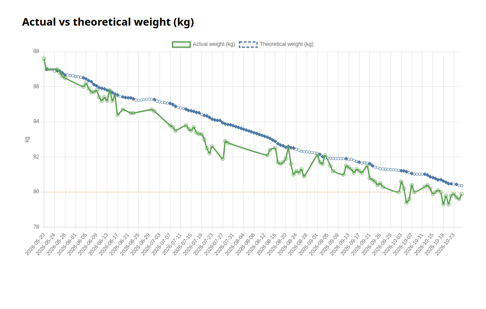

# diet-assistant

An AI agent that helps you reach the weight you want without just starving: lose fat, keep
muscle. You tell it what you ate and how you moved, in plain words. It keeps a daily log in
Markdown, runs small Node scripts for the math, and tells you where you stand.

**Not medical advice.** This is a tracking tool, not a diagnosis or a treatment. Talk to a doctor
before you start a diet, especially with a health condition. It is not for people under 18,
people who are pregnant or breastfeeding, or people with a BMI under 18.5.

## For agents: setting up from this URL

A user handed you this URL and wants their own copy. Ask for a folder name (default `my-diet`),
then:

1. With `gh` logged in (`gh auth status`):
   `gh repo create <name> --private --template dxmann73/diet-assistant --clone`.
2. Without `gh` or without a GitHub account:
   `git clone https://github.com/dxmann73/diet-assistant <name>`, then right away
   `git -C <name> remote rename origin template`. Tell the user their log stays local until they
   add a private remote of their own.
3. Never fork this repo. Never push to `dxmann73/diet-assistant`.
4. `cd <name>` and follow its `AGENTS.md`, which starts onboarding. If you load `AGENTS.md` only
   at session start, ask the user to restart you in that folder and say "initialize".

## Get started

1. Open any AI coding agent (for example Codex or Claude Code) in an empty folder and say
   `Set me up with https://github.com/dxmann73/diet-assistant`
   (German: `Richte mir https://github.com/dxmann73/diet-assistant ein`).
2. The agent makes your own private copy and starts onboarding: it asks for your language,
   explains the approach, and asks five short questions (sex, birth year, height, weight,
   daily life). Everything else it learns as you go. Some agents need a restart in the new
   folder first; then say "initialize".
3. From then on, just tell it what you ate and did: "Breakfast 08:00, 60 g oats with 200 g
   yogurt", "walked 40 minutes", "compute today".

Your copy must be private, never a fork: your log is health data, and a fork of a public repo is
public.

## The approach

The goal is to reach the weight you want without just starving. Starving alone makes the body
cut its energy use and, if you move little, lose muscle. Three principles:

1. **At most 500 kcal deficit a day.** That keeps it bearable, so you can keep going.
2. **Always eat at least your BMR** (basal metabolic rate, what the body burns at rest).
3. **Move as much as you can every day** to reach the 500 kcal. If you move more, eat enough
   that the deficit stays at 500 kcal at most.

The reason: at 500 kcal, hunger stays limited and bearable for longer, and the body loses
little or no muscle.

- **Weighing.** In the morning, fasted, after the toilet, always under the same conditions. The
  weight goes up and down from day to day, often by a kilo or more, mostly because of water.
  That is completely normal and no reason to worry. What counts is the 7-day average.
- **Estimating is fine.** On days you cannot weigh yourself, eat out, or go to a dinner or a
  party, just estimate and don't be too precise. The method is built for the long term.
- **Protein and fat.** The recommendation is at least 1.0 g of protein per kg of body weight
  (target 1.25 g/kg, top 1.5 g/kg). The log tracks it because many people eat too little
  protein. For fat it is 0.8 g per kg.
- **The deficit cap is a default.** You can change the 500 kcal in `profile.json`
  (`max_deficit_kcal`), or just ask the agent to change it.

## The chart



A real log over five months. The chart has two lines:

- **Theoretical weight** (blue, dashed): starts at your first weigh-in and drops by each day's
  computed deficit, at 7700 kcal per kg. The deficit comes from maintenance (BMR × the activity
  factor for your daily life), minus what you ate, plus what exercise burned. Filled points
  are closed days; hollow points are open or estimated days.
- **Actual weight** (green): your morning weigh-ins.

Day-to-day readings jump with water and food; the trend is what counts. If the two lines drift
apart for weeks, the estimates are off (for example the activity factor or portion sizes) and it
is time to reassess. (The thin orange line at 80 kg is a personal goal line from that log; it is
not part of the template.)

## How it works (low code)

The agent understands you; the scripts do the arithmetic.

- The agent turns your words into resolved lines in `protocols/YYYY-MM-DD.md`, asks about
  anything unknown, and adds new foods to `foods/foods.md`.
- `scripts/compute-day.js` computes the day: BMR (Mifflin-St Jeor), maintenance, intake, burn
  (MET × kg × hours), deficit, macro targets and flags, all with the working shown.
  Maintenance follows the 7-day average weight. The agent
  pastes its output into the log and never edits the numbers.
- `scripts/check-protocols.js` catches logs whose summary and numbers disagree;
  `scripts/gen-chart-cdn.js` draws `charts/chart-cdn.html`.
- Your settings live in three files the agent writes during onboarding: `profile.json` (body data
  and targets), `habits.json` (exercise MET values, daily defaults, what "a banana" means for
  you), `rules.md` (preferences such as reply style). When a meal or activity repeats, the
  agent offers to make it a recipe or a daily default.

Everything is plain Markdown and JSON, readable without the agent. Node 20 or newer, no
dependencies.

## Files

```text
AGENTS.md            instructions for the agent
profile.json         your body data and targets (created at onboarding)
habits.json          MET values, daily defaults, aliases (created at onboarding)
rules.md             your preferences (created at onboarding)
foods/foods.md       food database, starts with 15 staples
recipes/             composed dishes, one file each
protocols/           one file per day
charts/              the weight chart
docs/                the README picture
scripts/             the math
templates/           starting points for the files above
test/                tests for the scripts
```

## Tests

```sh
node --test
```

## Data sources

The starter values in `foods/foods.md` come from the Bundeslebensmittelschlüssel (BLS),
Version 4.0, published by the Max Rubner-Institut, licensed under
[CC BY 4.0](https://creativecommons.org/licenses/by/4.0/):

> Max Rubner-Institut (2025): Bundeslebensmittelschlüssel (BLS), Version 4.0 - Deutsche
> Nährstoffdatenbank. Karlsruhe. DOI:
> [10.25826/Data20251217-134202-0](https://doi.org/10.25826/Data20251217-134202-0)

BLS website: <https://www.blsdb.de/>. Changes: 15 foods were selected, and only energy, fat,
available carbohydrates, protein and total fibre per 100 g are used, rounded to whole kcal and
one decimal. Each row names its BLS code.

## License

MIT, see `LICENSE`. The BLS data keeps its CC BY 4.0 licence.
